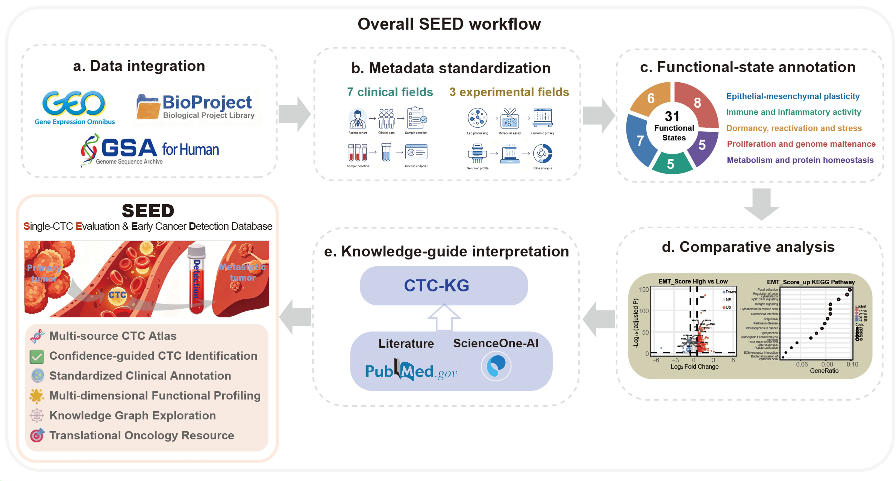

# SEED：An evidence-annotated resource for comparative analysis of circulating tumor cell states

SEED (Single-CTC Expression & Evaluation Database) is a reference atlas for comparing circulating tumor cell (CTC) transcriptional states across cancers. The current release covers 4,079 single-cell CTC transcriptomes and 98 bulk RNA-seq samples from 41 public datasets, 399 patients and 12 cancer types. Its 74-field metadata schema records source-study and assay context; per-cell evidence labels distinguish experimentally enriched from computationally inferred CTCs; and a shared collection of 31 curated gene sets organizes transcriptional activity into five biological themes. CTC-KG provides a separate, context-labelled interpretation layer linking CTC observations to pathways and other evidence sources.

Explore and download the atlas at **[db.cngb.org/seed](https://db.cngb.org/seed/)**. This repository contains a curated gene-set table and analysis scripts; large expression matrices and other processed data are distributed through the portal and the [archived release](https://doi.org/10.5281/zenodo.21900150). State scores support descriptive comparisons; they do not by themselves establish cross-platform calibration or functional causality.



## Repository structure

| Path                                | Contents                                                                                                     |
| ----------------------------------- | ------------------------------------------------------------------------------------------------------------ |
| `data/`                             | Curated 31-state gene sets included in this repository. Large matrices are downloaded separately.            |
| `examples/`                         | A runnable inspection of the included gene-set table.                                                        |
| `scripts/01_config/`                | Shared input and output paths, state names and plotting helpers.                                             |
| `scripts/02_preprocessing/`         | AnnData-to-Seurat conversion and preprocessing.                                                              |
| `scripts/03_state_analysis/`        | State scoring, high/low grouping and state-level differential analyses.                                      |
| `scripts/04_comparative_analysis/`  | Cancer-versus-other comparisons for single-cell and bulk data.                                               |
| `scripts/05_release/`               | Export of scored metadata and result manifests.                                                              |
| `scripts/06_confidence_validation/` | CNV-proxy and marker-expression checks.                                                                      |
| `scripts/07_CTC-KG/`                | Knowledge-graph construction and validation scripts, with additional external data and service requirements. |
| `assets/`                           | Repository figures.                                                                                          |

The portal's Download page provides harmonized expression matrices, standardized metadata, per-cell evidence labels, functional-state scores and CTC-KG exports. Source dataset accessions are listed in Supplementary Table S1 of the manuscript. The state definitions and source references are in [Supplementary Table S3](data/Supplementary%20Table%20S3.%20Curated%20gene%20sets%20and%20source%20references%20for%20the%2031%20functional%20states.csv).

## Installation

Clone the repository and run the commands below from its root directory:

```sh
git clone https://github.com/SiatBioInf/SEED.git
cd SEED
```

The core atlas scripts use **R 4.3 or later** and Seurat 5. Install the R packages in a project-specific library. The base gene-set example below needs only R; the additional packages support scoring, differential analysis, conversion and validation:

```r
install.packages(c(
  "Seurat", "Matrix", "dplyr", "ggplot2", "readxl", "patchwork",
  "tidyr", "ggrepel", "scales", "fs", "writexl", "BiocManager"
))
BiocManager::install(c(
  "zellkonverter", "SingleCellExperiment", "SummarizedExperiment",
  "clusterProfiler", "harmony", "org.Hs.eg.db", "enrichplot", "DESeq2", "infercnv"
))
```

Installation commands list required packages but are **not a version lock**.

The CTC-KG scripts use **Python 3.10 or later**. Install their Python dependencies separately:

```sh
python -m venv .venv
```

Activate it with `source .venv/bin/activate` on macOS/Linux or `.venv\Scripts\Activate.ps1` in Windows PowerShell, then install the packages:

```sh
python -m pip install neo4j requests biopython openai
```

These scripts require a configured Neo4j instance and access to the relevant third-party datasets or APIs. Set `NEO4J_PASSWORD` and, when using literature-model functions, `SEED_LLM_API_KEY` in your shell; `NEO4J_USER` defaults to `neo4j`. The [`.env.example`](.env.example) file lists the required environment variables.

## Data and code organization

Only the curated gene-set CSV is tracked in `data/`. Download the matrices needed for your analysis from the [SEED portal](https://db.cngb.org/seed/) and place them under `data/` using the filenames specified below, or update [`scripts/01_config/01_setup_paths.R`](scripts/01_config/01_setup_paths.R) for your local paths. All commands assume that you run them from the repository root.

| Input                                                                                                   | Used for                             | Required when                                |
| ------------------------------------------------------------------------------------------------------- | ------------------------------------ | -------------------------------------------- |
| `data/Supplementary Table S3. Curated gene sets and source references for the 31 functional states.csv` | State names, themes and gene symbols | Included; all state-scoring runs             |
| `data/SEED_scRNA.rds` or `data/SEED_scRNA.h5ad`                                                         | Single-cell atlas                    | State scoring and single-cell comparisons    |
| `data/SEED_bulkRNA.rds` or `data/SEED_bulkRNA.h5ad`                                                     | Bulk reference                       | Bulk cancer comparisons                      |
| `data/Non_CTC_10xPBMC_n28098.rds` or `.h5ad`                                                            | Blood-cell reference                 | CNV-proxy and marker validation              |
| `data/gencode.v44.annotation.gtf.gz`                                                                    | Gene coordinates                     | CNV-proxy analysis; override with `SEED_GTF` |

State scoring requires a Seurat object with gene symbols as feature names and an appropriately normalized RNA assay. Source-study metadata should be retained in the object. Large expression matrices and generated outputs/ are excluded from Git.

Source accessions provide links to the original experiments, the gene-set CSV defines the 31 functional states, and the SEED portal provide processed data for reuse. External classifier packages, primary datasets and third-party knowledge sources are not included in this repository.

## Usage examples

### Inspect the included state definitions

This example runs without atlas data or additional R packages:

```sh
Rscript examples/inspect_gene_sets.R
```

Expected summary: **31 functional states in 5 themes; median 50 genes per state, range 15-200**. The script also checks the declared gene counts against the listed gene symbols.

### Score a prepared SEED Seurat object

Place a downloaded, log-normalized single-cell Seurat object at `data/SEED_scRNA.rds`. If only an H5AD file is available, use the conversion command first, then verify that its RNA assay is normalized before scoring:

```sh
Rscript scripts/02_preprocessing/01_convert_h5ad_to_rds.R
Rscript scripts/03_state_analysis/01_score_ctc_states_and_groups.R
Rscript scripts/05_release/01_export_database_release_files.R
```

The conversion command skips missing H5AD files and existing RDS files. The scoring command computes AddModuleScore for the 31 gene sets and assigns a high/low label using the **median across its input cells**. To reproduce the atlas labels, score the full prepared atlas; scoring a subset gives a subset-specific median and different labels.

| Script                                                                      | Principal output                                                                                     |
| --------------------------------------------------------------------------- | ---------------------------------------------------------------------------------------------------- |
| `scripts/02_preprocessing/01_convert_h5ad_to_rds.R`                         | Converted `data/*.rds` inputs                                                                        |
| `scripts/03_state_analysis/01_score_ctc_states_and_groups.R`                | `outputs/03_SEED_scRNA_scored.rds` and `outputs/release_tables/scRNA_metadata_with_state_scores.csv` |
| `scripts/03_state_analysis/02_scRNA_state_DEG_GO_KEGG.R`                    | State-level DEG and enrichment files in `outputs/scRNA_state_analysis/`                              |
| `scripts/04_comparative_analysis/01_scRNA_cancer_vs_others_DEG_GO_KEGG.R`   | Cancer comparison files in `outputs/scRNA_cancer_vs_others/`                                         |
| `scripts/04_comparative_analysis/02_bulkRNA_cancer_vs_others_DEG_GO_KEGG.R` | Bulk comparison files in `outputs/bulkRNA_cancer_vs_others/`                                         |
| `scripts/05_release/01_export_database_release_files.R`                     | Download tables and a result manifest in `outputs/release_tables/`                                   |

For optional state-level or cancer-level differential analysis, run the corresponding script after scoring. These analyses need the full prepared input, the packages listed above and substantial memory. The CTC-KG scripts need separate input data and local configuration; the exported graph is available from the portal.

## Reproducibility and maintenance

This repository provides the analysis scripts and supporting resources for exploring and analyzing the SEED atlas. The complete 20.8 GB data release, including harmonized expression matrices and processed data, is available through the SEED database portal. Information on the four external CTC classifiers and source-study expression matrices is also available through the SEED portal.

Please report problems through GitHub Issues with the script name, input format, software versions and a minimal error message. Proposed changes should use pull requests and be reviewed by a maintainer.

## Maintainers

| Name     | Email                  | Affiliation                                                                                                                                                       |
| -------- | ---------------------- | ----------------------------------------------------------------------------------------------------------------------------------------------------------------- |
| Hao Yu   | <hao.yu@siat.ac.cn>    | Institute of Biomedical and Health Engineering, Shenzhen Institute of Advanced Technology, Chinese Academy of Sciences, Shenzhen, China                           |
| Xin Hong | <hongx@sustech.edu.cn> | Department of Biochemistry, SUSTech Homeostatic Medicine Institute, School of Medicine, Southern University of Science and Technology, Shenzhen, Guangdong, China |

## Citation and license

1. Ni X, Tang L, Cheng C, Wang Z, Xu Z, Min Y, Yang H, Zhang Y, Xie Z, Zhou P, Zuo Z, Yu H, Hong X. SEED: An evidence-annotated resource for comparative analysis of circulating tumor cell states. Manuscript submitted.
2. Tang L, Ni X, Cheng C, Min Y, Wang Z, Xu Z, Zhang Y, Zuo Z, Hong X, Yu H. CTC-KG: A Multi-Layer, Context-Aware Knowledge Graph for Circulating Tumor Cells Integrating Literature Assertions with Patient-Level Single-Cell Statistics. Manuscript submitted.

Source code is licensed under the [MIT License](LICENSE). 
